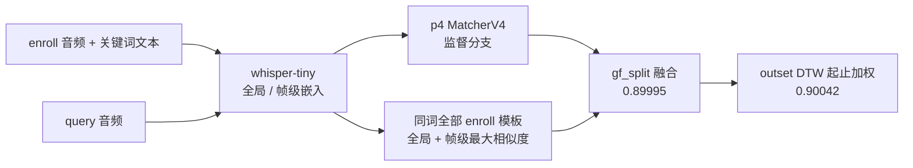

# 多模态开放词汇关键词检索挑战赛（MISP-QEKS）

[](https://github.com/Alwayshere-su/misp-qeks-multimodal-kws/actions/workflows/ci.yml)
[](LICENSE)
[](requirements.txt)
[](#-赛事成绩)

> MISP-QEKS · Multimodal Open-Vocabulary Keyword Spotting · 团队 **MILK**

本项目是参加 **科大讯飞开发者大赛——多模态开放词汇关键词检索挑战赛** 的算法实现与实验记录。

**English summary** — Query-by-Example Keyword Spotting on the MISP-QEKS dataset: decide whether a query utterance contains the keyword spoken in an enrollment clip, for arbitrary (open-vocabulary) keywords. The final system combines whisper-tiny embeddings, a supervised p4 matcher, unsupervised multi-template matching and DTW-based score fusion, reaching **0.90042 AUC** (Top 6 / 317 teams). Code is Apache-2.0; competition data and model weights are not redistributed.

## 🏆 赛事成绩

| 项目 | 结果 |
|---|---|
| 主办方 | 国家语音及语言信息处理工程研究中心、中国科学技术大学 |
| 参赛队伍 | 317 支 |
| 初赛排名 | **Top 6 / 317（前 2%）** |
| 最佳得分（AUC） | **0.90042** |
| 提交次数 | 18 次 |

最佳得分对应归档文件 `submission/submit_gf_dtw.csv`（依据 `opt/make_gf_dtw_v2.py` 中的记录）。仓库内次优为 `submission/submit_mt_gf_split.csv` 的 0.89995。

### 分数演进

| 阶段 | 线上 AUC | 提交 |
|---|---:|---|
| v3 MFCC 基线（未收录） | 0.6466 | `submit_v3_auc0.6466.csv`（已归档） |
| p4 监督匹配 | 0.82755 | `submit_p4_full.csv` |
| 多模板 + p4 | 0.89143 | `submit_mt_split.csv` |
| 全局 + 帧级多模板 | 0.89995 | `submit_mt_gf_split.csv` |
| 五信号融合 | 0.89386 | `submit_final_boost.csv` |
| **+ outset DTW** | **0.90042** | `submit_gf_dtw.csv` |

## 📖 项目背景

赛事要求通过示例进行关键词检索（Query-by-Example）：给定一段 enroll 音频及其关键词文本，判断 query 音频中是否说了该关键词。关键词是**开放词汇**，测试集中会出现训练时没见过的词，因此不能依赖固定词表分类器。

- 数据规模：训练 500K 对、开发 10K 对、评测 seen / blind 各 50K 对
- 线上评分：`0.5 × AUC_inset + 0.5 × AUC_outset`
- 提交格式：`id,type,prediction`，共 100,000 行

## 🛠️ 技术方案

**最终链路**：whisper-tiny 特征 → p4 监督匹配模型 → 无监督多模板匹配 → split 感知融合 → outset DTW 起止加权。



1. **声学特征**：whisper-tiny 编码器提取 log-mel 的 384 维全局嵌入与帧级嵌入；另用 whisper-base 嵌入补充多模板。没有训练或微调编码器。
2. **监督分支（p4）**：MatcherV4 在 10K 开发集上训练（全量 / seen→unseen / 5 折），融合 enroll 文本字符编码与音频相似度，线上 0.82755。
3. **无监督多模板**：同一关键词的全部 enroll 音频都作为模板，取 query 与模板的最大相似度，分全局嵌入与帧级两版，再按 inset/outset 分别加权融合 p4，达到 0.89995。
4. **最终融合**：在 `submit_mt_gf_split.csv` 基础上，对 outset 引入全模板 DTW 起止权重（inset 0.05 / outset 0.3），得到 0.90042。

**没有走通的路线**（详见「关键结论」）：500K 训练、ASR 文本匹配、判别性归一化、TTA、视频分支、重训练。

## 📊 核心挑战与解决方案

1. **开放词汇（OOV）**：不使用固定词表，把同词所有 enroll 样本当作模板，用无监督相似度为每个 query 动态打分；这比在 10K 开发集上训练的监督模型更能泛化到 blind 词。
2. **跨录音域偏移**：开发集与测试集虽然同分布但录音独立，监督模型在开发集上 CV 0.987、线上只有 0.83。解决方案是把权重交给不依赖训练标签的无监督信号。
3. **噪声鲁棒性**：尝试过 SNR map 加权与质量分层，但没有记录到稳定的线上收益，最终未进入主线。
4. **多模态利用**：视频唇读嵌入做过验证（seen 全局余弦 AUC 0.572），信号弱于音频，最终未用于提交。

## 📁 目录结构

```text
.
├── whisper_encoder.py          # whisper-tiny 编码器 + log-mel（所有特征的基础）
├── train_whisper_p1~p4.py      # 各版本匹配模型；p4 最强
├── train_matcher_v5.py         # V5 训练（历史脚本，output_v5 已删除）
├── asr_pipeline.py             # ASR 分析管线（ASR 路线最终失败）
├── lipreading_encoder.py       # 唇读视频编码器
├── scripts/                    # 整理后的脚本
│   ├── submission/             # 提交生成与融合
│   ├── features/               # 特征提取
│   ├── analysis/               # 分析 / 校验
│   ├── baseline/               # 旧基线
│   ├── asr/                    # ASR 实验
│   └── tools/                  # 工具
├── opt/                        # 比赛期间的实验场（见 opt/README.md）
├── submission/                 # 5 个关键提交 CSV（见 submission/README.md）
├── tests/                      # 提交格式与哈希校验（CI 同款）
├── docs/                       # 赛题、资产说明、整理记录（见 docs/README.md）
│   └── history/                # 2026-08 的历史笔记与计划
├── .github/workflows/ci.yml    # CI：Python 语法检查 + 提交校验
├── output_whisper/             # 核心特征缓存（不入库）
├── output_p4/                  # 最终 p4 模型权重（不入库）
├── output/ output_v2/ output_v3e/ output_lip/  # 历史实验产物（不入库）
├── train/ test/ val/ 辅助资源/  # 官方数据与预训练模型（不入库）
├── requirements.txt
├── CITATION.cff                # 引用信息
├── CONTRIBUTING.md             # 贡献指南
├── CHANGELOG.md                # 版本记录
├── .gitignore
└── .gitattributes
```

根目录的 `whisper_encoder.py`、`train_whisper_p4.py` 等被 `opt/` 与 `scripts/` 多处 import，**不要移动**。

## 🚀 快速开始

官方数据不随仓库分发。请自行获取后按 `train/`、`test/`、`val/`、`辅助资源/` 放到项目根目录。

```bash
pip install -r requirements.txt
```

脚本默认把项目根解析为仓库根目录（`Path(__file__)` 向上查找），不需要改代码；也可以用环境变量覆盖：

```bash
export MISP_ROOT=/path/to/this/repo    # Windows: set MISP_ROOT=D:\path\to\repo
```

```bash
# 1) 复现 p4 基线提交（需要 output_whisper/ 特征与 output_p4/best_full.pt）
python scripts/submission/make_submission_p4.py \
    --model output_p4/best_full.pt \
    --out submission/submit_p4_full.csv

# 2) 生成多模板与融合提交
python opt/make_multitemplate_submit.py

# 3) 在归档的 gf_split 基础上生成最优 DTW 融合（0.90042）
python opt/make_dtw_submit.py
```

> 注意：`submit_mt_gf_split.csv`（0.89995）的生成脚本没有保留在仓库中，只有读取它的后续融合脚本；复现最优结果依赖仓库里已归档的该 CSV。其余说明见 `submission/README.md`。

## ✅ 复现与验证

仓库不包含数据与权重，但保留的提交可以独立校验，CI 每次 push 都会跑：

```bash
python tests/check_submissions.py
```

- 5 个 CSV 均为 100,000 行，inset / outset 各 50,000，id 覆盖 0–49999；
- 最优文件 `submit_gf_dtw.csv` 的 SHA256 为 `b77b5ffe…`，脚本逐字节比对；
- 用归档的 `opt/_dtw_{inset,outset}_full.npy` 与 `submit_mt_gf_split.csv` 重跑融合，输出与归档文件字节一致；
- `make_dtw_submit.py --val-only` 在开发集上得到 dev_seen **0.8453** / dev_unseen **0.9792**。

完整 DTW 重算（约 30–50 分钟）不在 CI 中，依赖 `output_whisper/test_{inset,outset}.pkl` 与 `output_p4/` 权重。

## 📦 提交文件

`submission/` 只保留 5 个有关键分数的提交（约 10 MB）；其余 81 个实验版本在仓库外的 `_archive_misp_submissions/`，不参与版本控制。最优文件的格式、分数来源与 SHA256 见 [`submission/README.md`](submission/README.md)。

## 🔍 关键结论（踩坑记录）

1. **开发集内评估不可靠**：val 的标签由“关键词文本是否出现在 query 转写中”决定，存在同源泄漏；CV 0.987 / seen→unseen 0.963 都是假象，线上实测 0.83。
2. **500K 训练集无效**：录音环境与测试集存在偏移，训练后 inset 反而更差。
3. **ASR 路线失败**：whisper-tiny 对真实会议音频幻觉严重，精确命中率 <10%。
4. **无监督多模板是唯一稳定增益**：0.82755 → 0.89995，再加 DTW → 0.90042。
5. **判别性增强、TTA、重训练在测试集上均掉分**。

## 👥 团队信息

- 团队名称：**MILK**
- 我的角色：核心算法开发 / 数据处理 / 模型调优

## 🤝 贡献与引用

- 贡献方式与本地检查见 [`CONTRIBUTING.md`](CONTRIBUTING.md)，行为准则见 [`CODE_OF_CONDUCT.md`](CODE_OF_CONDUCT.md)，版本变化见 [`CHANGELOG.md`](CHANGELOG.md)。
- 引用本仓库请使用 [`CITATION.cff`](CITATION.cff)；GitHub 页面右上角 “Cite this repository” 可直接导出 BibTeX。

## 📄 数据与许可

官方数据集版权归主办方所有，本仓库不包含数据、特征缓存与模型权重（见 `.gitignore`）。代码采用 **Apache License 2.0**，见 [`LICENSE`](LICENSE)。
